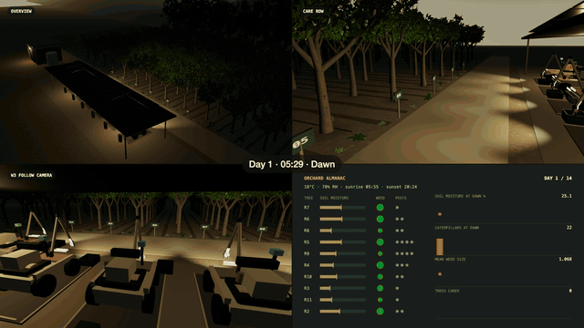

# Wall-ne

**An AI orchard fleet that coordinates work, responds to failures, and turns every run into training data.**

Wall-ne connects fleet-level reasoning with camera-guided robot control in a persistent 3D orchard. An orchestrator allocates work, individual robots inspect and treat trees, and an evidence pipeline captures decisions alongside measured outcomes. Python owns the simulation and validates every action; Three.js provides the orchard, onboard cameras, and operator views.



## Orchestration

The orchestration layer turns orchard demand into coordinated robot assignments. The intended model architecture pairs **Nemotron Super VL** for fleet reasoning with **Nemotron Nano Omni 30B** for local perception and manipulation. Model routes are configurable and pinned per session; current defaults and implementation status are listed below.

### Dispatch and event monitoring

The orchestrator selects from feasible assignments using outstanding work, worker availability, resource reserves, and fleet health. Each full-care assignment starts a linked worker session with its own observations, model calls, and completion checks. Workers can treat different trees concurrently, while a shared navigation reservation controls access through the orchard apron.

Telemetry runs independently of inference: robots emit health samples at each 0.05-second physics substep and a 1 Hz heartbeat. Position, battery, water, task progress, and faults establish operational health; arm workers additionally report joint angles, tool pose, grip force, load, and contact. The runtime distinguishes legitimate waiting from stale heartbeats, stalled actions, and repeated attempts without progress.

### Self-healing through event response

In the fleet recovery mission, a new incident brings the orchestrator back into the decision loop. It can query recent telemetry and record a response to continue, retrieve, reassign, stop, or escalate to an operator.

If a worker breaks down, recovery combines physical retrieval with redistribution of unfinished work:

1. The failed action stops, preserving work already completed and releasing unfinished work for reassignment.
2. The towing robot, **R1**, travels to the disabled worker, attaches, tows it back, and parks it at its dock.
3. The fleet can activate spare worker **W5** and redistribute assignments across available robots to meet the original demand.
4. Independent checks evaluate coverage, resource reserves, recovery, and return-to-dock requirements before accepting completion.

Retrieved robots remain disabled for the run. In the full-care mission, healthy workers continue when another worker fails, and the orchestrator can assign outstanding tasks to available workers. Physical towing is implemented in the fleet recovery mission.

### Decisions grounded in telemetry

Recent heartbeat history gives the orchestrator evidence for its next decision: whether a robot is advancing, waiting for an image, running low on resources, or repeating an ineffective action. Incident responses retain a reason alongside the event that triggered them. This makes dispatch and recovery decisions inspectable and creates examples for improving later policies.

## Individual robot actions

Each robot follows an **observe → act → measure → verify** loop. The intended local model is **Nemotron Nano Omni 30B**, receiving camera images and permitted sensor readings and returning structured tool calls. The simulator validates those calls against task ownership, resource limits, observation freshness, and physical constraints.

| Action | Perception and control | Measured outcome |
| --- | --- | --- |
| **Water** | Inspect the tree, read moisture, and aim metered delivery into the root basin. | Delivered water and the remaining moisture target. |
| **Fertilize** | Read the nutrient prescription and dispense within stock and basin constraints. | Recorded fertilizer delivery against the tree's requirement. |
| **Remove pests** | Locate pests in the current image and direct a bounded vacuum action. | Contact and removal checks, including protected-organism checks. |
| **Remove weeds** | Use wrist RGB and LiDAR to align a six-axis arm, close the gripper, extract, carry, and release the weed into a collection bin. | Independent contact, load, extraction, and collection checks. |

Robot observations exclude hidden weed and insect coordinates. Image and scan submissions are tied to the correct worker, session, frame, and revision. For manipulation, inverse kinematics and swept-link collision checks constrain motion; grip force, load, and root resistance determine whether an extraction succeeds. A model's completion claim must pass the simulator's checks.

The intended escalation path sends difficult observations to a more capable model, preserving the same inputs and action constraints. Automatic escalation based on task difficulty is a next step. The current runtime supports explicit model selection and an opt-in provider/protocol fallback; physical misses remain recorded failures for review.

## Self-improvement

Every new live session captures model inputs, decisions, execution events, and measured outcomes. Before inference, the runtime saves the filtered observation, pinned prompt, tool schema, and camera inputs. Decisions are then linked to command receipts, telemetry, and independent checks in Supabase, with images and compressed traces in private artifact storage.

That record supports a repeatable improvement cycle:

1. **Build evidence sets.** Export committed sessions and linked worker runs, verifying artifact hashes and retaining model, prompt, and scenario provenance.
2. **Ask a stronger teacher.** Replay the exact inputs available at decision time to a selected larger model for alternative tool calls. Later outcomes remain evaluation evidence and do not leak into earlier observations.
3. **Prepare training data.** Validate labels against the action schema, separate text and multimodal examples, and group related sessions and scenario seeds into the same split to prevent train/validation leakage.
4. **Fine-tune on rented Crusoe GPUs.** Provision a GPU VM with the included Terraform configuration and train a versioned LoRA adapter from the selected dataset.
5. **Evaluate robot behavior.** Compare the candidate against a baseline on frozen and held-out orchard scenarios, measuring completion, rejected actions, organism damage, resource reserves, latency, and reported cost.

The goal is to fine-tune **Nano Omni for better robot-arm control**, turning successful grasps, failed alignments, and recovery attempts into a reusable training corpus. The repository already exports multimodal evidence sets; its current training recipe targets **Nemotron Nano 8B text tool calls**. Nano Omni vision training requires a compatible model-loading and adapter recipe. Teacher labels alone do not establish physical success, and adapters are not automatically deployed.

See the [distillation and Crusoe training runbook](docs/DISTILLATION.md) for the complete pipeline.

## Implementation and validation

- **Current model defaults:** Crusoe-hosted Nemotron 3 Super for planning, orchestration, and verification; Nemotron 3 Nano for fleet workers and retrieval; Gemma 4 for camera-guided treatment. Super VL is an explicit Gateway option. The Super VL / Nano Omni pairing above describes the intended model architecture.
- **Live manipulation evidence:** The documented Gemma-on-Crusoe wrist-control series completed five of six orchard trials. The failed trial exposed a localization error retained for review. See [wrist-control results](docs/WRIST_CONTROL.md).
- **Training status:** Evidence export, teacher labeling, dataset construction, the Nano 8B LoRA recipe, and Crusoe provisioning are implemented. A GPU fine-tune and subsequent robot-policy evaluation remain unrun.
- **Demo footage:** The GIF is a deterministic, scripted season film using the simulator's care commands and physical checks. It illustrates the environment; live-model results are recorded separately.

See [architecture](docs/ARCHITECTURE.md) for system boundaries and [validation](docs/VALIDATION.md) for measured results and remaining gates. Robot mechanics and orchard quantities are simulation parameters.

## Run

Python 3.9+ and Node 22+ are required. The selected validation runtimes are recorded in `docs/DEPENDENCIES.md`.

```sh
npm ci
cp .env.example .env  # only when .env does not already exist
# Fill backend credentials. Never commit .env.
npm run check
npm test
npm start
```

Open http://127.0.0.1:8765/ for fleet control, `/treatment.html` for treatment and manipulation, or `/sessions.html` for recorded evidence. Use `python3 -m simulator.server --port 8766` for another loopback port.

Apply the ordered SQL files in `supabase/migrations/` to the configured project before persisted runs. They create service-only tables, fenced atomic commit RPCs, immutable evidence, prompt gates, and the private `robot-session-artifacts` bucket. The provided wall-ne project has been provisioned during this build. Pure simulation tests need no database. Integration checks are explicit:

```sh
WALLNE_INTEGRATION=1 python3 -m unittest tests.test_persistence_integration -v
WALLNE_HTTP=1 python3 -m unittest tests.test_http_integration -v
```

Use a dedicated test project when running persistence integration tests; they create retained, labeled test sessions. The HTTP checks require the local app running.
